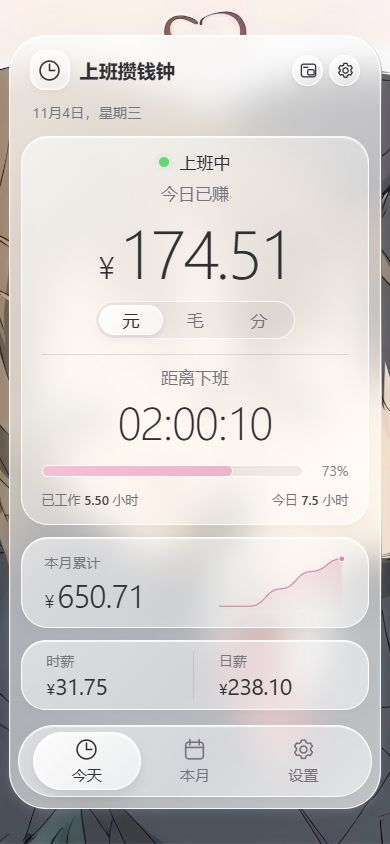

# 上班攒钱钟

一个玻璃质感的实时工资计数器。把收入、工时和下班倒计时，放在清爽的竖屏界面里。

**[打开网页版](https://ggbond2424648901.github.io/salary-glass-clock/) · [下载 Windows 桌面版](https://github.com/GGBond2424648901/salary-glass-clock/releases/latest/download/SalaryClock-Windows-x64.zip) · [所有版本](https://github.com/GGBond2424648901/salary-glass-clock/releases)**


## 桌面小窗

一边处理任务，一边看收入增长。

- **独立运行**：Windows 桌面版不依赖已打开的 Chrome / Edge，退出浏览器后仍可继续显示。
- **默认置顶**：小窗浮在普通应用上方，可拖动、调整尺寸，也可取消置顶。
- **紧凑模式**：缩成一条轻量计数条，保留金额、倒计时与工作进度。
- **随窗口适配**：主界面按窗口宽高整体缩放，小窗的字号、间距同步响应尺寸；缩小后内容保持完整，展开时恢复之前的小窗大小。
- **柔和切换**：页面交接、面板高度、月份、工作日展开和紧凑模式使用连贯过渡，连续点击按最后一次选择收尾。
- **随时返回**：点右上角的展开图标回到主界面，修改工资和排班。

<p>
  
  
</p>

小窗截图为浏览器模式；Windows 桌面版增加了置顶开关。


### 使用 Windows 桌面版

1. 下载 [SalaryClock-Windows-x64.zip](https://github.com/GGBond2424648901/salary-glass-clock/releases/latest/download/SalaryClock-Windows-x64.zip)。
2. 解压整个压缩包，运行文件夹内的 **SalaryClock.exe**，无需另装浏览器或 Node.js。
3. 在“设置”里填好月薪、工作日、上下班与午休，点击“保存设置”。
4. 点击标题右侧的“小窗模式”图标，主界面会收起，置顶小窗继续计数。

小窗右上角依次是：紧凑 / 展开、置顶、返回主界面、关闭。点击金额也能切换元、毛、分。关闭最后一个可见窗口会退出程序；不会自动开机启动。

### 使用网页小窗

打开网页版，点击标题右侧的“小窗模式”，选择“开启置顶小窗”。桌面 Chrome / Edge 等支持 Document Picture-in-Picture 的浏览器，可以在切换应用、最小化浏览器后继续显示小窗。

**网页小窗需要保留原网页和浏览器进程。彻底关闭浏览器后还想继续显示，请使用独立桌面版。** 手机和不支持此 API 的浏览器仍可正常使用完整网页；界面会提示选择桌面版。

## 工资与排班

| 功能 | 支持内容 |
| --- | --- |
| 排班 | 双休、单休、自定义每周工作日 |
| 时间 | 上下班时间、可选午休、跨夜班次 |
| 统计 | 今日已赚、本月累计、时薪、日薪、已工作时长 |
| 倒计时 | 上班 / 下班倒计时、当天工作进度 |
| 金额显示 | 元、毛、分；每赚 1 分、1 毛、1 元跳动 |
| 本月 | 真实月历、每日估算、累计收入曲线、排班预计 |
| 保存 | 当前浏览器或桌面版本地保存，无账号、无服务器数据库 |

<p>
  
  
  
</p>

## 计算方式

`时薪 = 月薪 ÷ 当月排班工作日 ÷ 每天计薪工时`

`已赚收入 = 时薪 × 已工作时间（扣除午休）`

按当月实际星期分布计算，已过工作日按满勤估算。节假日、法定调休、请假、加班、税费暂未自动计入；修改设置会重新估算整月。跨夜班按班次开始日期归属当月。月度实线表示已赚，虚线表示后续排班估算。

设置仅在当前设备与应用内保存，不会自动跨设备同步。收入展示属于排班估算，不代表实际工资条。

## 本地开发

需要 Node.js 24+。

```sh
npm ci
npm run dev
```

打开终端输出的 `http://127.0.0.1:4173`。网页源码在 `dist/`，本身不需要构建工具。

```sh
npm start             # 运行独立桌面版
npm test              # 工资、存储降级、小窗生命周期测试
npm run package:win   # 打包 Windows x64 桌面版
```

`npm ci` 会从 Electron 官方分发下载桌面运行时。Windows 打包结果在 `release/SalaryClock-win32-x64/`，完整解压目录共同组成桌面版。

目录结构：

```text
dist/             网页、完整界面、小窗与共用计算引擎
desktop/          独立窗口、置顶和安全 IPC
tests/            计算与窗口行为测试
docs/screenshots/ 实际页面截图
.github/workflows/ 自动测试与 GitHub Pages 发布
```

## 技术说明

界面采用原生 HTML / CSS / JavaScript，沿用生图设计稿中的玻璃层次、圆角和轻动效。Windows 版基于 Electron，使用本地资源、隔离的渲染进程和受限 IPC。小窗按当前时间重新计算，避免后台定时器累积误差。

网页小窗的生命周期约束见 [Chrome 官方说明](https://developer.chrome.com/docs/web-platform/document-picture-in-picture)；桌面置顶能力见 [Electron BrowserWindow 文档](https://www.electronjs.org/docs/latest/api/browser-window)。

## 许可

代码采用 [MIT License](LICENSE)。页面背景插画由用户提供，不包含在代码的 MIT 授权范围内，相关权利归原权利人。
